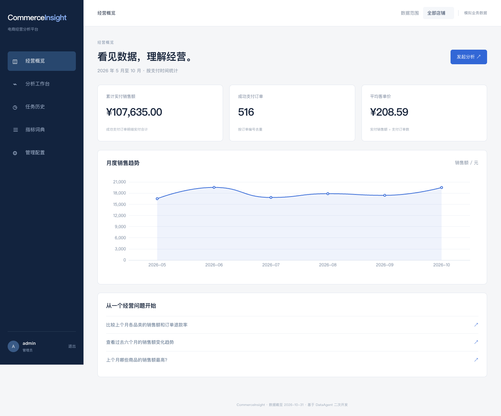

# CommerceInsight｜电商经营分析平台

面向电商运营的 Java 全栈分析项目。用户可以通过自然语言提出经营问题，追踪分析计划与 SQL 执行过程，查看表格、图表、指标口径及历史报告。

项目基于 [Spring AI Alibaba DataAgent](https://github.com/spring-ai-alibaba/DataAgent) 二次开发，固定上游版本为 `27e7baa85db868a7364a977031f8f705d5988f1c`，沿用 Apache-2.0。个人改造集中于电商指标、店铺权限、受约束查询、持久化任务和可核验评测。



## 运行环境

| 组件 | 版本 |
| --- | --- |
| Java | 17 |
| Spring Boot | 3.4.8 |
| Spring AI / Spring AI Alibaba | 1.1.2 / 1.1.2.2 |
| MySQL | 8.4 |
| 前端 | Nuxt 4、Vue 3、Vuetify 3、ECharts 6 |
| Node.js / pnpm | 本次验证使用 24.22.1 / 12.15.0 |
| 模型 | DeepSeek `deepseek-flash` |

## 快速开始

### 本地开发

启动 Docker Desktop，复制配置示例，将模型凭据放入当前终端环境。

```bash
cp .env.example .env
export CI_MODEL_KEY="${ANTHROPIC_AUTH_TOKEN:-}"
docker compose up -d mysql
```

当前终端已有的 `ANTHROPIC_AUTH_TOKEN` 可直接由本项目读取，实际服务采用 DeepSeek OpenAI 兼容接口。其他终端可自行设置 `CI_MODEL_KEY`。`.env` 主要用于 Docker Compose，直接启动 Java 时使用终端环境变量。

等待 MySQL 健康检查通过，在两个终端分别执行。

```bash
bash commerce/scripts/start-backend.sh
```

```bash
bash commerce/scripts/start-frontend.sh
```

打开 [本地工作台](http://localhost:3000)。后端监听 `8065`，专用 MySQL 映射到 `127.0.0.1:3308`。

### Docker Compose 完整运行

```bash
export CI_MODEL_KEY="${ANTHROPIC_AUTH_TOKEN:-}"
docker compose up --build -d
```

Compose 提供前端、Java 后端及 MySQL，数据保存在 `commerce_mysql` 卷中。首次启动导入六个月固定种子数据。后续启动复用已有数据。

### 演示账号

| 账号 | 角色 | 数据范围 |
| --- | --- | --- |
| `admin` | 管理员 | 全部店铺或单个店铺 |
| `analyst1` | 分析员 | 杭州旗舰店 |
| `analyst2` | 分析员 | 上海精选店 |

初始密码由 `CI_DEMO_PASSWORD` 设置，默认 `CommerceDemo!2026`。本项目提供的数据库账号和演示密码用于本机模拟数据。用户首次创建后保存密码哈希，修改环境变量会应用于全新用户初始化。

## 可演示流程

1. 使用 `analyst1` 登录，查看杭州旗舰店的经营概览。
2. 在分析工作台输入“比较上个月各品类的销售额和订单退款率”，参考日期选 `2026-11-13`。
3. 查看指标与表结构检索、分析计划、SQL 执行、结果保存和报告生成事件。
4. 查看结果表格、图表、实际执行 SQL、计算日期和证据引用，导出 JSON 报告。
5. 刷新页面或进入任务历史，重新打开结果。运行中的任务支持取消，失败任务支持重试。
6. 使用管理员查看预算和店铺授权，使用 `analyst2` 验证店铺隔离。

## 业务口径

- 销售额统计支付成功订单的明细实付金额，归属支付时间。
- 退款金额统计去重后的成功退款，归属退款成功时间。
- 订单退款率采用支付订单队列，分子为截至分析时点存在成功退款的去重订单数。品类维度使用该品类的明细关联退款。
- 净销售额采用期间销售额减期间退款金额，展示跨期退款的口径影响。
- 金额保留两位小数，率保留六位，分母为零展示“无可计算数据”。

模拟数据覆盖 `2026-05-01` 至 `2026-10-31` 的订单，以及跨期退款，包含 576 个订单、768 条明细和 204 条退款采集记录。退款视图按 `refund_no` 去重。新品品类保留零销售场景。

## 设计与个人贡献

| 子系统 | 复用与改造 |
| --- | --- |
| Agent | 复用 Spring AI Alibaba Graph、上游模型工厂与 Spring AI 调用方式，新增电商专用四阶段 Graph |
| 业务知识 | 新增指标词典、别名匹配、定义版本及授权 Schema 上下文 |
| 查询安全 | 复用 Druid AST 和上游行数、超时常量，新增递归表/函数校验、受控视图账号、聚合风险检查及取消 |
| 任务管理 | 新增用户归属、幂等创建、状态机、事件补读、历史证据、取消与重启处理 |
| 前端 | 沿用上游 Nuxt 工程，复用结果表格组件和 ECharts renderer，新增登录、概览、工作台、历史及管理界面 |
| 评测 | 新增固定业务问题、标准 SQL、真实模型对照、API 冒烟和 MySQL 集成测试 |

专用入口为 `com.carefreelove.commerce.CommerceInsightApplication`。该入口扫描电商业务包，现有上游源码保留于原包中，便于追溯。图编排和模型能力的来源与业务新增分别记录在[设计决策](commerce/docs/DESIGN.md)。

## 模型预算

- 默认每任务最多 12 次模型调用，单次输出最多 4096 tokens，排队及执行总时限 180 秒。
- 调用前在 MySQL 事务中预留费用，成功后按 usage 结算，缺少 usage 时保留预留额度。
- 本项目预算上限 18 元，另留 2 元余量。金额采用官方 Flash 高峰、未命中缓存价格及保守 `8 CNY/USD` 折算。
- 自动测试使用模型桩，模型桩输出带 `TEST_STUB` 标记。真实评测与演示读取实际模型服务。

## 测试与评测

```bash
./mvnw -B -s commerce/maven-settings.xml -pl data-agent-management -Dspotless.skip=true test
```

启动本项目 MySQL 后，可以运行包含真实数据库检查的完整测试。

```bash
CI_INTEGRATION=true ./mvnw -B -s commerce/maven-settings.xml -pl data-agent-management -Dspotless.skip=true test
```

后端运行时执行 API 检查及真实模型评测，评测会消耗已配置服务的额度。

```bash
python3 commerce/scripts/smoke_test.py
python3 commerce/scripts/evaluate.py --baseline --output commerce/evaluation/local-results.json
cd data-agent-frontend-nuxt
pnpm test:unit
pnpm build
```

评测脚本额外使用本地 `mysql` 客户端读取标准答案。固定问题、标准 SQL、原始结果和当前验证结论见[评测记录](commerce/docs/EVALUATION.md)。

## 文档

- [设计理由、实现方法与验证方式](commerce/docs/DESIGN.md)
- [实际测试与模型评测记录](commerce/docs/EVALUATION.md)
- [演示步骤与面试讲解](commerce/docs/DEMO_AND_RESUME.md)
- [原始 DataAgent 文档](https://github.com/spring-ai-alibaba/DataAgent/tree/27e7baa85db868a7364a977031f8f705d5988f1c/docs)
- [Apache-2.0 许可证](LICENSE)
