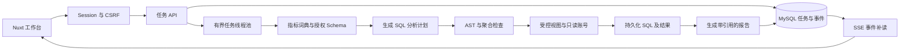
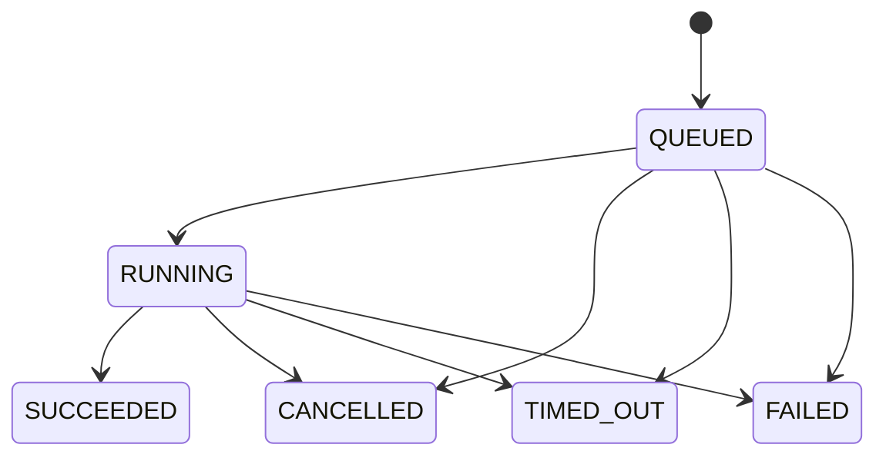

# 设计决策与实现记录

## 从业务问题到实现

本项目关注电商经营数据的自然语言分析。一次分析需要回答三个问题，用户有权查询哪些数据，计算采用什么口径，结果能通过哪些 SQL 和数据复核。

## 为什么保留上游并增加业务入口

上游面向通用数据智能体，已经具备模型配置、知识检索、Graph 编排和报告相关代码。电商第一版采用固定业务域和单一 Chat 服务，适合集中实现授权上下文及结果证据。

因此保留完整 Git 历史与原包，新增专用应用入口和 `knowledge → plan → execute → report` Graph。默认启动电商入口，扫描范围为 `com.carefreelove.commerce`。工作流复用 Graph 的节点、状态及调用接口。原有通用 Graph 源码作为上游实现保留。

上游 `DynamicModelFactory` 新增接受 `RetryTemplate` 的重载。原调用沿用默认重试，电商调用选择单次尝试，SQL 纠错由业务流程显式发起并计入预算。前端复用 `ChatResultSet` 和 `useEchartsRenderer`。

## 为什么使用词典与数据库视图

第一版指标数量有限，指标名称和别名足以形成可核对的检索依据。每次检索携带指标定义、版本及匹配词，核心口径始终进入分析上下文。表结构从当前范围的 JDBC 元数据获取。

店铺隔离同时在 Java 和 MySQL 实现。服务端校验用户授权，再选择店铺对应的只读账号和视图 Schema。视图的店铺条件由数据库执行，账号仅能查询该 Schema。管理库使用独立账号，分析凭据由服务端环境提供。

SQL 通过 Druid AST 递归检查。CTE、子查询及 UNION 中的表引用都需要授权，函数采用允许列表。结果最多展示 1000 行，额外读取一行判断是否截断，SQL 时限使用上游的 30 秒常量。

固定评测发现过 LEFT JOIN 的日期过滤仅放在 ON 中，汇总直接读取明细金额的情况。新增聚合风险检查会识别此种结构并提供明确纠错信息，同时加入回归测试。复杂业务语义仍通过固定标准 SQL 评测记录验证。

## 为什么任务与 SSE 分离

浏览器刷新和网络重连属于展示层行为。任务先保存到 MySQL，进入两个工作线程的有界队列，再执行 Graph。关闭页面后任务继续运行，取消按钮显式改变任务状态并取消模型 Future 和 JDBC Statement。

事件先持久化，再由 SSE 按递增序号读取。客户端携带 `Last-Event-ID` 可补读事件，完成后关闭连接。每次订阅与补读均重新检查任务归属及店铺授权。

终态通过条件 UPDATE 抢占，完成、取消、超时和失败只有一个终态生效。报告与成功事件在同一事务内提交。排队和执行共用 180 秒时限，启动时将遗留任务标记为中断失败，重试生成关联的新任务。

## 为什么采用预留式预算

模型请求可能失败或超时，供应商仍可能已经处理请求。调用前按上下文字节数、模板余量及最大输出计算保守预留，在同一数据库事务内扣减可用预算并保存调用记录。

响应返回 usage 后，以输入、输出 tokens 及固定计价结算。缺少 usage 的记录保留预留，状态为 `UNKNOWN`。预算对本项目所有用户共享，实际服务账单可再依据供应商账单核对。

计价检查日期为 2026-11-13，Flash 输入高峰未命中缓存每百万 tokens 为 0.30 美元，输出为 1.20 美元，采用 8 元人民币兑 1 美元的保守预算换算。[DeepSeek 官方价格](https://api-docs.deepseek.com/quick_start/pricing/)

## 验证设计选择

- 单元测试覆盖 AST、危险函数、嵌套越权、LEFT JOIN 聚合风险、角色范围、模型取消和计价。
- MySQL 集成测试覆盖启动初始化、只读视图、退款去重、Graph 流程、幂等、终态竞争和预算事务。
- API 脚本覆盖登录、CSRF、跨用户任务与事件、跨店铺、历史及取消。
- 真实模型评测保存每道题的标准 SQL、实际 SQL、数据结果、报告、耗时及 tokens。
- 浏览器检查覆盖登录、经营概览、历史报告、刷新恢复和窄屏布局。
